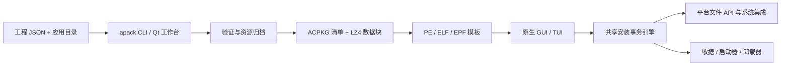

# 实现与数据格式

`src/core/` 不依赖 STL、异常、RTTI 或 POSIX，使用受限 JSON DOM、UTF-8 字符串、SHA-256、分块 LZ4 解码。运行时主入口在 `src/runtime/main.cpp`，三个 GUI 位于 `src/ui/`。`src/platform/` 封装 Windows Unicode API、Linux 本地接口和 XAPI。宿主打包器允许使用 C++17 标准库，EPF 转换库只链接到宿主工具。

## ACPKG v1

所有整数均为小端无符号整数。文件以 64 字节头开始：

| 偏移 | 字节数 | 内容 |
| --- | --- | --- |
| 0 | 8 | ASCII `ACPKG001` |
| 8 | 4 | 版本 `1` |
| 12 | 4 | 头大小 `64` |
| 16 | 8 | UTF-8 JSON 清单字节数 |
| 24 | 8 | 数据区域字节数 |
| 32 | 32 | 清单原始字节的 SHA-256 |

随后为 JSON 清单和连续数据区域。清单包含已编译的目标、品牌资源、入口、选项以及文件索引。每个文件记录 `path`、`size`、`sha256`、`mode`、`policy`、可选 `component` 和 `chunks`；每块记录相对数据区域的 `offset`、压缩长度 `stored`、解码长度 `size` 与 `codec`（`store` / `lz4`）。块最大解码长度 256 KiB。LZ4 压缩后不变小时使用原始块。解压使用约 514 KiB 堆缓冲，避免占用 XJ380 原生线程栈。

清单上限 16 MiB，JSON 嵌套深度上限 64，文件索引上限 100,000 条。解析拒绝重复键、无效 UTF-8、整数溢出、重复目标、文件与目录冲突及路径穿越。构建时按路径排序，数据块按文件顺序写入，不写入构建时间戳。对于相同工程、源文件字节、权限和模板，原生归档内容可重复生成。

PE / ELF 单文件安装器是 `模板 | ACPKG | 64 字节尾部`。尾部为：

| 偏移 | 字节数 | 内容 |
| --- | --- | --- |
| 0 | 8 | ASCII `ACFTR001` |
| 8 | 8 | ACPKG 文件偏移 |
| 16 | 8 | ACPKG 长度 |
| 24 | 32 | 整个 ACPKG 的 SHA-256 |
| 56 | 8 | 原始模板大小 |

运行时先校验整个附加归档，再解析清单；每个实际解压的文件另验 SHA-256。独立 `.acpkg` 没有尾部，依靠清单和逐文件校验。这些散列用于完整性检查，不验证发布者身份。

## 原生资源和 EPF

Windows 模板保留 `.apicon` 资源空间，构建器生成 RT_ICON、RT_GROUP_ICON 与 asInvoker manifest，再写入 PE 资源目录。图标填充不改变模板文件大小，因此尾部偏移和辅助程序裁剪保持一致。

XJ380 链接脚本生成固定地址 x86-64 ELF：代码 RX、数据 RW、非执行栈和一个预留的 PT_NULL。生成 EPF 时将该预留项改为只读 PT_LOAD，把 ACPKG 作为加载段加入，修补 `.apembed` 中的地址、长度、原始模板大小与散列，再调用官方 elf2epf 转换。EPF 的 OS ABI 为 `0x0380`、ABI 版本 1、映射对齐 4096，最大 256 MiB。

EPF 运行时从内存映射段读取归档，不依赖文件尾覆盖。归档额外包含原始 ELF 模板，用于生成后续原生 ELF 启动器和卸载器。`apack inspect` 用官方 EPF 解码器验证结构，再独立校验嵌入包。ELF 和 EPF 模板都没有动态解释器或 libc 依赖。

## 安装生命周期

1. 解析包与选项，验证平台、许可、目标路径、组件依赖及所需权限。
2. 独占创建相邻事务目录 `<root>.accretion-txn`，保存日志、备份和解压暂存文件。
3. 验证每个选中文件后，复制到目标文件旁的临时文件，再重命名；更新与删除之前备份旧内容。
4. 应用快捷方式、环境、注册表和关联，记录变更前后的快照。
5. 生成启动器与卸载器，写入收据和产品安装索引，提交事务后清理临时文件并发送环境变更 / 更新关联缓存。

出现错误或取消时逆序恢复。文件恢复也在目标文件系统创建临时文件，支持应用目录与桌面 / 配置目录位于不同卷。目录创建记录在日志中，失败时只删除空目录。日志先于相应变更写入，已有事务目录阻止第二次安装。中断恢复由显式 `--recover` 处理，不能并发运行。

Linux 文件写入执行 fsync，Windows 写入执行 FlushFileBuffers，XJ380 使用 XAPI 提供的文件接口。不同系统的目录同步、重命名和缓存持久性保证并不相同；不能仅根据进程中断测试推断断电原子性。

## 收据与卸载

`.accretion/receipt.json` 保存目标清单、安装范围、用户选择、安装文件散列与集成快照。辅助程序在 `.apctx` 保留 16 KiB 上下文，存储安装根路径、运行模式、可选入口与参数，因此不依赖当前工作目录或原安装包。辅助启动器读取收据，组合环境变量与参数，再调用原生启动接口。

升级先撤销旧集成，再应用新版本集成，在同一事务中处理。文件若采用 `preserve` 策略则保留已有用户内容；移除不再需要的旧文件时，只删除仍匹配旧收据散列的文件。卸载也只删除仍由安装器拥有的文件和集成，保留用户修改。环境追加操作记录贡献的元素，普通值和文件以快照 / 散列判断所有权。

当前收据与日志为本机受信任安装状态，不是可从网络接收并以管理员权限导入的配置格式。全系统安装应使用管理员控制的目标目录；路径静态检查拒绝链接，但没有实现针对所有平台文件竞态的能力安全文件系统沙箱。

## 标准与原生接口参考

- [XAPI 1.4](https://docs.xingjisoft.com/develop/xj380/XJ380_API_Spec_CPP_1_4)：文件、权限、进程、GUI、控制台。
- [Desktop Entry Exec](https://specifications.freedesktop.org/desktop-entry/latest/exec-variables.html)：参数引用、两层转义和字段码。
- [Shared MIME-info](https://specifications.freedesktop.org/shared-mime-info/latest/ar01s02.html)：XML 包位置和缓存更新。
- [environment.d](https://www.freedesktop.org/software/systemd/man/latest/environment.d.html)：用户服务环境与变量展开。
- [Windows Default Programs registration](https://learn.microsoft.com/en-us/windows/win32/shell/default-programs)：ProgID、Capabilities 和 RegisteredApplications 结构；当前 Windows 默认程序最终由用户选择。
